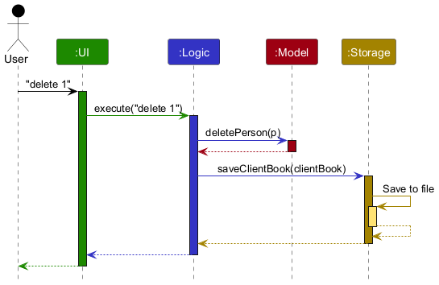
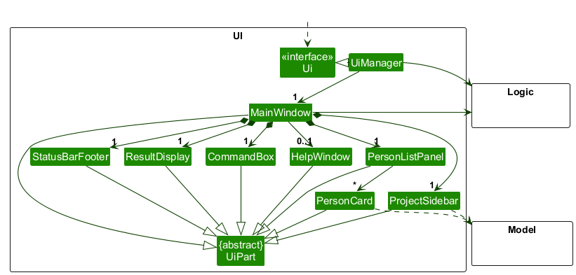
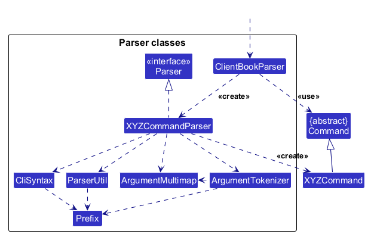
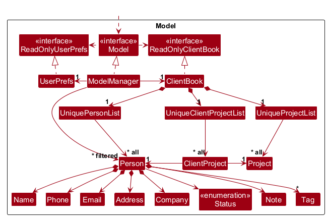
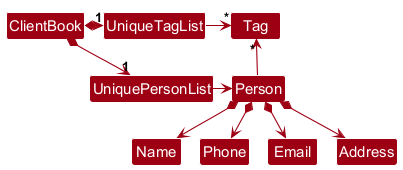
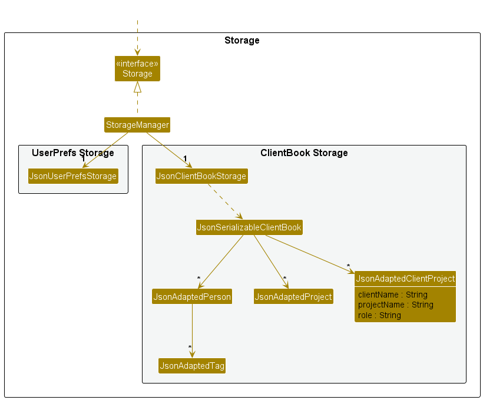
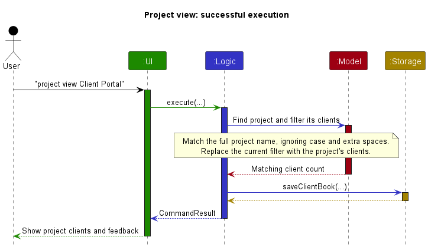

* Table of Contents
{:toc}

--------------------------------------------------------------------------------------------------------------------

## **Acknowledgements**

* _{List the sources of reused or adapted ideas, code, documentation, and third-party libraries here, with links to the originals.}_

--------------------------------------------------------------------------------------------------------------------

## **Setting up, getting started**

Refer to the guide [_Setting up and getting started_](SettingUp.md).

--------------------------------------------------------------------------------------------------------------------

## **Design**

:bulb: **Tip:** The `.puml` files used to create diagrams are in `docs/diagrams`. Refer to the [_PlantUML Tutorial_ at se-edu/guides](https://se-education.org/guides/tutorials/plantUml.html) to learn how to create and edit diagrams.

### Architecture

The ***Architecture Diagram*** given above explains the high-level design of the App.

The following provides a quick overview of the main components and their interactions.

**Main components of the architecture**

**`Main`** (consisting of classes [`Main`](https://github.com/AY2627S1-CS2103-F09-2/tp/tree/master/src/main/java/seedu/address/Main.java) and [`MainApp`](https://github.com/AY2627S1-CS2103-F09-2/tp/tree/master/src/main/java/seedu/address/MainApp.java)) is in charge of the app launch and shut down.
* At app launch, it initializes the other components in the correct sequence, and connects them up with each other.
* At shut down, it shuts down the other components and invokes cleanup methods where necessary.

The bulk of the app's work is done by the following four components:

* [**`UI`**](#ui-component): The UI of the App.
* [**`Logic`**](#logic-component): The command executor.
* [**`Model`**](#model-component): Holds the data of the App in memory.
* [**`Storage`**](#storage-component): Reads data from, and writes data to, the hard disk.

[**`Commons`**](#common-classes) represents a collection of classes used by multiple other components.

**How the architecture components interact with each other**

The *Sequence Diagram* below shows how the components interact with each other for the scenario where the user issues the command `delete 1`.

Each of the four main components (also shown in the diagram above),

* defines its *API* in an `interface` with the same name as the Component.
* provides its functionality through a concrete `{Component Name}Manager` class that implements the corresponding API interface.

For example, the `Logic` component defines its API in `Logic.java` and implements it in `LogicManager.java`. Other components interact with a component through its interface rather than its concrete class, preventing them from coupling to that component's implementation, as illustrated in the following partial class diagram.

The sections below give more details of each component.

### UI component

The **API** of this component is specified in [`Ui.java`](https://github.com/AY2627S1-CS2103-F09-2/tp/tree/master/src/main/java/seedu/address/ui/Ui.java)

The UI consists of a `MainWindow` and its parts, such as `CommandBox`, `ResultDisplay`, `ProjectSidebar`, `PersonListPanel`, and `StatusBarFooter`. All of these, including `MainWindow`, inherit from the abstract `UiPart` class, which captures common behavior among classes that represent visible GUI parts.

The `UI` component uses the JavaFX UI framework. The layouts of these UI parts are defined in matching `.fxml` files in `src/main/resources/view`. For example, [`MainWindow.fxml`](https://github.com/AY2627S1-CS2103-F09-2/tp/tree/master/src/main/resources/view/MainWindow.fxml) specifies the layout of [`MainWindow`](https://github.com/AY2627S1-CS2103-F09-2/tp/tree/master/src/main/java/seedu/address/ui/MainWindow.java).

The `UI` component,

* executes user commands using the `Logic` component.
* listens for changes to `Model` data so that the UI can be updated with the modified data.
* keeps a reference to the `Logic` component, because the `UI` relies on the `Logic` to execute commands.
* depends on some classes in the `Model` component because it displays `Person` objects from the model.

The `ProjectSidebar` lists **Contacts** and every project with its number of clients. Clicking an item runs the same command a user could type (`list` or `project view PROJECT`) through `MainWindow#executeCommand`, so a click behaves exactly like the command, including its result message, and focus then returns to the `CommandBox`. To highlight the current item, the sidebar observes the `Model`'s `ContactView` (all contacts, one project, or another filter such as a `find`), which every command that changes the displayed list updates.

### Logic component

**API** : [`Logic.java`](https://github.com/AY2627S1-CS2103-F09-2/tp/tree/master/src/main/java/seedu/address/logic/Logic.java)

Here's a (partial) class diagram of the `Logic` component:

The sequence diagram below illustrates the interactions within the `Logic` component, taking `execute("delete 1")` API call as an example.

:information_source: **Note:** The lifeline for `DeleteCommandParser` should end at the destroy marker (X), but due to a limitation of PlantUML, it continues to the end of the diagram.

How the `Logic` component works:

1. When `Logic` is called upon to execute a command, the command is passed to a `ClientBookParser` object, which in turn creates a parser that matches the command (e.g., `DeleteCommandParser`) and uses it to parse the command.
1. This results in a `Command` object (more precisely, an object of one of its subclasses e.g., `DeleteCommand`) which is executed by the `LogicManager`.
1. The command can communicate with the `Model` when it is executed (e.g. to delete a person). 
   Note that although this is shown as a single step in the diagram above for simplicity, the code can require several interactions between the command object and the `Model` to complete the operation.
1. The result of the command execution is encapsulated as a `CommandResult` object which is returned from `Logic`.

Here are the other classes in `Logic` (omitted from the class diagram above) that are used for parsing a user command:

How the parsing works:
* When called upon to parse a user command, the `ClientBookParser` class creates an `XYZCommandParser` (`XYZ` is a placeholder for the specific command name, e.g., `AddCommandParser`). The parser uses the other classes shown above to parse the user command and create an `XYZCommand` object (e.g., `AddCommand`). The `ClientBookParser` returns that object as a `Command` object.
* All `XYZCommandParser` classes, such as `AddCommandParser` and `DeleteCommandParser`, implement the `Parser` interface so they can be treated similarly where appropriate, for example during testing.

### Model component
**API** : [`Model.java`](https://github.com/AY2627S1-CS2103-F09-2/tp/tree/master/src/main/java/seedu/address/model/Model.java)

The `Model` component,

* stores the client book data i.e., all `Person` objects (in a `UniquePersonList`), all `Project` objects (in a `UniqueProjectList`), and which clients are on which project, as `ClientProject` objects (in a `UniqueClientProjectList`). A client can be on many projects and a project can have many clients, so the diagram shows `ClientProject` as an association class on the `Person`–`Project` association: each `ClientProject` links one client to one project.
* gives each `Person` an optional `Company`, a `Status` (one of none, lead, active, on hold, done) and an optional `Note`. A missing company, address or note is stored as an empty value (e.g. `Company.EMPTY`) rather than `null`, so other code never has to check for `null`.
* stores the `Person` objects selected by the current filter, such as search results, in a separate _filtered_ list. It exposes this list as an unmodifiable `ObservableList<Person>` that the UI can observe and bind to, so the UI updates when the list changes.
* stores a `UserPrefs` object that represents the user’s preferences (currently, just the GUI settings). This is exposed to the outside as a `ReadOnlyUserPrefs` object.
* does not depend on any of the other three components (as the `Model` represents data entities of the domain, they should make sense on their own without depending on other components)

:information_source: **Note:** The alternative, arguably more object-oriented, design below keeps a unique list of tags in `ClientBook`, and each `Person` references tags from that list. This lets `ClientBook` maintain one `Tag` object per unique tag instead of each `Person` holding its own `Tag` objects. 

### Storage component

**API** : [`Storage.java`](https://github.com/AY2627S1-CS2103-F09-2/tp/tree/master/src/main/java/seedu/address/storage/Storage.java)

The `Storage` component,
* can save both client book data (contacts, projects and which clients are on which project) and user preference data in JSON format, and read them back into corresponding objects.
* is implemented by `StorageManager`, which delegates the actual JSON file access to `JsonClientBookStorage` and `JsonUserPrefsStorage` (one class per data file).
* saves each project membership as a `JsonAdaptedClientProject` holding the client's name, the project's name and the role, and links them back to the loaded `Person` and `Project` when reading the file.
* depends on some classes in the `Model` component (because the `Storage` component's job is to save/retrieve objects that belong to the `Model`)

### Common classes

Classes used by multiple components are in the `seedu.address.commons` package.

--------------------------------------------------------------------------------------------------------------------

## **Implementation**

This section describes some noteworthy details on how certain features are implemented.

### Project view feature

#### Implementation

`project view PROJECT` uses `ProjectViewCommand` to find a project by name, ignoring case and extra spaces, and filter the client list to its members. The UI observes the filtered list and displays a client count or an empty-project message.

The sequence diagram below shows the successful flow for `project view Client Portal`, including the save performed by `LogicManager` before returning a `CommandResult` to the UI.

Diagram source: [PlantUML](diagrams/ProjectViewSequenceDiagram.puml).

### Client status, company and notes

#### Implementation

Each `Person` has three fields beyond AB3's: a `Status`, a `Company` and a `Note`.

* `Status` is an enum with the values `NONE`, `LEAD`, `ACTIVE`, `ON_HOLD` and `DONE`. `Status#fromText` turns what the user typed into a status, ignoring case and treating `on-hold`, `onhold` and `on   hold` the same; it returns an empty `Optional` for anything else, which `ParserUtil#parseStatus` turns into a `ParseException`.
* `Company` and `Note` are value classes like `Address`. A contact without one holds `Company.EMPTY` or `Note.EMPTY`, never `null`, so the card, storage and `find` can use the value directly without checking for `null`.
* `Person` stays immutable. `status` and `note` each have a command of their own, which builds the updated contact with `Person#withStatus` or `Person#withNote` and replaces the old one with `Model#setPerson`. `edit` copies the status and note across unchanged, so editing a contact's phone number never clears them.
* `list s/STATUS` gives `ListCommand` an optional status filter, which it passes to `Model#updateFilteredPersonList` as a predicate.
* `JsonAdaptedPerson` saves the three fields as `"status"`, `"company"` and `"note"`. A missing or blank field is read as `NONE` or empty, so data files from older versions still load.

The sequence diagram for `status 1 active` follows the same pattern as the [`delete 1` example](#logic-component): `ClientBookParser` creates a `StatusCommandParser`, which returns a `StatusCommand`; executing it calls `Model#setPerson` with the updated contact, and `LogicManager` then saves the client book.

#### Design considerations

**Aspect: how the status is set**

* **Alternative 1 (current choice):** a separate `status INDEX STATUS` command.
  * Pros: Changing a client's status is the most frequent update, and the command is short. `status 1 on hold` reads naturally without a prefix.
  * Cons: One more command to learn.
* **Alternative 2:** an `s/STATUS` field in `add` and `edit`.
  * Pros: Fewer commands.
  * Cons: `edit 1 s/on hold` is longer, and `add` would need to handle a status for contacts who are not clients (e.g. a finance officer). `add` and `edit` reject `s/` with a message pointing to `status`.

**Aspect: how a missing company or note is represented**

* **Alternative 1 (current choice):** a shared empty value (`Company.EMPTY`, `Note.EMPTY`, as already done for `Address.EMPTY`).
  * Pros: No `null` checks anywhere; the card simply hides the line when the value is empty.
  * Cons: Code must use `isEmpty()` rather than comparing with `null`.
* **Alternative 2:** `Optional<Company>` and `Optional<Note>` fields.
  * Pros: The type shows that the value may be missing.
  * Cons: Every use has to unwrap the `Optional`, and Jackson needs extra handling to save it.

--------------------------------------------------------------------------------------------------------------------

## **Documentation, logging, testing, dev-ops**

* [Documentation guide](Documentation.md)
* [Testing guide](Testing.md)
* [Logging guide](Logging.md)
* [DevOps guide](DevOps.md)

--------------------------------------------------------------------------------------------------------------------

## **Appendix: Requirements**

### Product scope

**Target user profile**: Freelance software developer who works with multiple different customers and collaborate with many people.
They prefer typing to mouse interactions and are reasonably comfortable using CLI apps.

**Value proposition**: Centralizes client management inside a desktop CLI to replace bulky customer relationship management apps, allowing them to modify client statuses, organize projects easily, and group related people/customer

### User stories

Priorities: High (must have) - `* * *`, Medium (nice to have) - `* *`, Low (unlikely to have) - `*`

| User type | User story | Benefit | Priority |
| --- | --- | --- | --- |
| new user | create a new contact |  | `* * *` |
| new user | delete a contact I no longer deal with | it keeps the client book clean | `* * *` |
| new user | View all contacts on the app | I can see my contacts | `* * *` |
| user ready to start for real | clear all the sample data in one command | I can begin from a clean state without deleting entries one by one | `* * *` |
| new user | see a list of the commands available | I can learn what the app does without leaving it to read a manual | `* * *` |
| new user | see an example of the correct format when I mistype a command | I can fix my mistake without guessing at the syntax | `* * *` |
| freelance developer | add a client with a name, email and phone number | I stop keeping their details scattered across chats and emails | `* * *` |
| freelance developer | add a contact who is not the client themselves, such as their finance officer | I can reach the right person for the right matter | `* * *` |
| freelance developer | list every contact I have recorded | I can see everything in one place | `* * *` |
| freelance developer | edit a contact's details | their record stays correct when they change number, email or job | `* * *` |
| freelance developer | delete a contact I no longer deal with | my list does not fill up with people who are no longer relevant | `* * *` |
| forgetful user | undo my last command | I can recover from a mistake without retyping what I lost | `* * *` |
| freelance developer | tag a contact with a project | I can see who is involved in which piece of work | `* * *` |
| freelance developer | tag one contact with more than one project | a client I work with on several jobs is still recorded only once | `* * *` |
| freelance developer | list only the contacts on a given project | I can see everyone involved in the job I am working on right now | `* * *` |
| freelance developer | remove a tag from a contact | the record follows along when someone leaves a project | `* * *` |
| freelance developer | search for a contact by part of their name | I can find them without remembering the exact spelling | `* * *` |
| returning user | have my data saved without asking | I never lose work by forgetting to save | `* * *` |
| potential user exploring the app | see the app already populated with sample data | I can tell what it looks like in use before committing my own records | `* *` |
| new user | see where my data file is kept | I know what to back up | `* *` |
| freelance developer | record the company a contact belongs to | I can tell apart two people with similar names | `* *` |
| freelance developer | be warned when I add someone whose email is already recorded | I do not end up with the same person twice | `* *` |
| freelance developer | search by company | I can find everyone I know at a client organisation | `* *` |
| freelance developer | set a status on a client such as lead, active, on hold or done | I know where each engagement stands | `* *` |
| freelance developer | list clients by status | I can see which engagements need attention this week | `* *` |
| freelance developer | change a client's status in a single command | keeping my pipeline current is quick enough that I actually do it | `* *` |
| freelance developer | record the role a contact plays on a project, such as product owner or designer | I know who to approach about what | `* *` |
| long-time user | sort my contacts by name | the list is in a predictable order when I scan it | `* *` |
| long-time user | sort clients by status | the work that needs attention appears first | `* *` |
| user who made several mistakes in a row | undo more than one command | I can walk back a wrong sequence, not just the last step | `* *` |
| cautious user | have my data kept in a plain readable file | I can back it up, inspect it, or repair it by hand | `* *` |
| freelancer moving between machines | copy my data file to another computer | I can keep working on my laptop as well as my desktop | `* *` |
| freelance developer | keep a short note against a contact | I remember context such as their timezone or how they prefer to be contacted | `*` |
| freelance developer | see how many contacts each project has | I can gauge how large each engagement is | `*` |
| expert user | type short aliases for the commands I use most | I spend less time typing the same things | `*` |
| expert user | act on several contacts in one command | I do not repeat the same command once per person | `*` |
| expert user | recall and edit a command I typed earlier | I can repeat or amend it without typing it out again | `*` |
| long-time user | archive the contacts of a finished project | my working list stays short without losing the records | `*` |
| long-time user | look at archived contacts | I can still reach someone from a past job | `*` |
| user with a long list | page through my contacts | the display stays readable when there are hundreds of them | `*` |
| freelance developer | export one project's contacts | I can hand the list to a collaborator | `*` |

*{More to be added}*

### Use cases

(For all use cases below, the **System** is `ClientBookThree` and the **Actor** is the `user`, a freelance software developer, unless specified otherwise)

**Use case: UC01 - Add a contact**

**MSS**

1.  User requests to add a contact, giving their name, phone number, email and address, and optionally some tags.
2.  ClientBookThree adds the contact and shows the details of the added contact.

    Use case ends.

**Extensions**

* 1a. A required detail is missing.

    * 1a1. ClientBookThree shows an error message with the expected format.
    * 1a2. User enters the details again.

      Steps 1a1-1a2 are repeated until all required details are given. 
      Use case resumes from step 2.

* 1b. A detail is invalid, e.g., the phone number contains letters.

    * 1b1. ClientBookThree shows an error message stating what is allowed for that detail.
    * 1b2. User enters the details again.

      Steps 1b1-1b2 are repeated until all details are valid. 
      Use case resumes from step 2.

* 1c. A contact with the same name already exists.

    * 1c1. ClientBookThree shows an error message saying the contact already exists, and does not add it.

      Use case ends.

**Use case: UC02 - List all contacts**

**MSS**

1.  User requests to list all contacts.
2.  ClientBookThree shows every contact, numbered in the order they were added.

    Use case ends.

**Extensions**

* 2a. There are no contacts.

    * 2a1. ClientBookThree shows an empty list.

      Use case ends.

**Use case: UC03 - Delete a contact**

**MSS**

1.  User lists contacts (UC02) or finds contacts (UC05).
2.  User requests to delete a specific contact in the shown list.
3.  ClientBookThree deletes the contact and shows the details of the deleted contact.

    Use case ends.

**Extensions**

* 1a. The shown list is empty.

  Use case ends.

* 2a. The given index is invalid, e.g., it is not a positive number or is larger than the number of contacts shown.

    * 2a1. ClientBookThree shows an error message.

      Use case resumes at step 2.

**Use case: UC04 - Edit a contact**

**MSS**

1.  User lists contacts (UC02) or finds contacts (UC05).
2.  User requests to change some details of a specific contact in the shown list, giving the new values.
3.  ClientBookThree updates the contact and shows its new details.

    Use case ends.

**Extensions**

* 2a. The given index is invalid.

    * 2a1. ClientBookThree shows an error message.

      Use case resumes at step 2.

* 2b. No detail to change is given.

    * 2b1. ClientBookThree shows an error message saying at least one detail must be given.

      Use case resumes at step 2.

* 2c. A new value is invalid.

    * 2c1. ClientBookThree shows an error message stating what is allowed for that detail.

      Use case resumes at step 2.

* 2d. The new name is the same as that of another contact.

    * 2d1. ClientBookThree shows an error message saying that contact already exists, and does not change anything.

      Use case ends.

**Use case: UC05 - Find contacts by name or company**

**MSS**

1.  User requests to find contacts, giving one or more keywords.
2.  ClientBookThree shows the contacts whose name or company contains any of the keywords, ignoring case.

    Use case ends.

**Extensions**

* 1a. No keyword is given.

    * 1a1. ClientBookThree shows an error message with the expected format.

      Use case resumes at step 1.

* 2a. No contact matches any keyword.

    * 2a1. ClientBookThree shows an empty list and says no contact was found.

      Use case ends.

**Use case: UC06 - Tag a contact with a project**

**MSS**

1.  User lists contacts (UC02) or finds contacts (UC05).
2.  User requests to tag a specific contact in the shown list with one or more projects.
3.  ClientBookThree adds the projects to the contact and shows its updated details.

    Use case ends.

**Extensions**

* 2a. The given index is invalid.

    * 2a1. ClientBookThree shows an error message.

      Use case resumes at step 2.

* 2b. A project name is invalid.

    * 2b1. ClientBookThree shows an error message stating what a project name may contain, and does not tag the contact.

      Use case resumes at step 2.

* 2c. The contact is already tagged with every given project.

    * 2c1. ClientBookThree tells the user that nothing has changed.

      Use case ends.

**Use case: UC07 - Remove a contact from a project**

**MSS**

1.  User lists contacts (UC02) or finds contacts (UC05).
2.  User requests to remove a project from a specific contact in the shown list.
3.  ClientBookThree removes the project from the contact and shows its updated details.

    Use case ends.

**Extensions**

* 2a. The given index is invalid.

    * 2a1. ClientBookThree shows an error message.

      Use case resumes at step 2.

* 2b. The contact is not tagged with that project.

    * 2b1. ClientBookThree shows an error message listing the projects the contact is tagged with.

      Use case resumes at step 2.

**Use case: UC08 - View the contacts on a project**

**MSS**

1.  User requests to list the contacts tagged with a specific project.
2.  ClientBookThree shows those contacts and how many there are.

    Use case ends.

**Extensions**

* 1a. The project name is invalid.

    * 1a1. ClientBookThree shows an error message stating what a project name may contain.

      Use case resumes at step 1.

* 2a. No contact is tagged with that project.

    * 2a1. ClientBookThree shows an empty list and says no contact is on that project.

      Use case ends.

**Use case: UC09 - Update a client's engagement status**

**MSS**

1.  User finds the client (UC05).
2.  User requests to set the engagement status of that client to one of lead, active, on hold or done.
3.  ClientBookThree updates the client's status and shows the client's updated details.

    Use case ends.

**Extensions**

* 2a. The given index is invalid.

    * 2a1. ClientBookThree shows an error message.

      Use case resumes at step 2.

* 2b. The given status is not one of the allowed statuses.

    * 2b1. ClientBookThree shows an error message listing the allowed statuses.

      Use case resumes at step 2.

* 2c. The client already has that status.

    * 2c1. ClientBookThree tells the user that nothing has changed.

      Use case ends.

**Use case: UC10 - Undo a mistaken change**

**MSS**

1.  User makes a change to the contacts by mistake, e.g., deletes the wrong contact (UC03).
2.  User requests to undo the last change.
3.  ClientBookThree reverses the last change and says which change was undone.

    Steps 2-3 are repeated for as many changes as the user wants to undo. 
    Use case ends.

**Extensions**

* 2a. There is no change left to undo.

    * 2a1. ClientBookThree shows an error message saying there is nothing to undo.

      Use case ends.

### Non-Functional Requirements

1.  Should work on any _mainstream OS_ as long as it has Java `25` or above installed.
2.  Should be able to hold up to 1000 persons and 100 projects without noticeable sluggishness (up to 1 second of load times) in performance for typical usage.
3.  A user with above average typing speed for regular English text (i.e. not code, not system admin commands) should be able to accomplish most of the tasks in their typical workflow faster using commands than using the mouse.
4.  A new user should be able to add, delete and list contacts using the documented command syntax without assistance after reading the quick-start instructions.
5.  After a successful change, the updated data should remain available after the application is closed and reopened.
6.  Contact and project data should be stored locally and not transmitted elsewhere to ensure privacy of user data.
7.  The application should be able to function as usual without needing an internet connection.
8.  A newer version of the application should be able to read data from an older version of the application.
9.  The application window should fit within screens with minimally 1920x1080 resolution.

### Glossary

* **Mainstream OS**: Windows, Linux, Unix, or macOS.
* **Private contact detail**: A contact detail that is not meant to be shared with others.
* **Client**: A person or organization that engages the user to do work
* **Contact / Person**: A person recorded in the app, such as a client’s main contact, finance contact, or collaborator.
* **Collaborator**: A person who works with the user on a project but is not the client.
* **Project**: A piece of work or engagement associated with a client and one or more people.
* **Status**: The project's stage, using the allowed values `lead`, `active`, `on hold`, and `done`.
* **Project tag**: Represents a contact's involvement in a project.
* **Typical usage**: The dataset size and command mix used to evaluate the performance NFR.
* **Quick-start instructions**: Brief summary of the user guide, contains important information to get started using CB3.

--------------------------------------------------------------------------------------------------------------------

## **Appendix: Instructions for manual testing**

Given below are instructions to test the app manually.

:information_source: **Note:** These instructions only provide a starting point for testers to work on;
testers are expected to do more *exploratory* testing.

### Launch and shutdown

1. Initial launch

   1. Download the JAR file and copy it into an empty folder.

   1. Open a terminal in that folder and run `java -jar clientbook.jar`. 
      Expected: The GUI opens with six sample contacts, some with a company. The window size may not be optimal.

1. Saving window preferences

   1. Resize the window to an optimal size. Move the window to a different location. Close the window.

   1. Relaunch the app with `java -jar clientbook.jar`. 
       Expected: The most recent window size and location are retained.

### Adding and deleting a contact

1. Adding a contact

   1. Test case: `add n/Mei Ling p/+65 9123 4567 e/meiling@acme.com c/Acme Pte Ltd` 
      Expected: Mei Ling is added at the end of the list, with `Acme Pte Ltd` under her name and no address line.

   1. Test case: `add n/mei   LING p/91111111 e/other@example.com` 
      Expected: Rejected as a duplicate: names are compared ignoring case and extra spaces.

   1. Test case: `add n/Jane Tan p/12 e/jane@example.com` 
      Expected: Rejected. The message says a phone number needs at least 3 digits.

1. Deleting a contact while all contacts are being shown

   1. Prerequisites: List all contacts using the `list` command, with multiple contacts in the list.

   1. Test case: `delete 1` 
      Expected: The first contact is deleted from the list, and from every project they were in. The status message shows the deleted contact's details.

   1. Test case: `delete 0` 
      Expected: No contact is deleted. An error message says the index is invalid.

   1. Other incorrect delete commands to try: `delete`, `delete x`, `delete 999` (where 999 is larger than the list size) 
      Expected: No contact is deleted, and an error message is shown.

### Status and notes

1. Setting and listing by status

   1. Test case: `status 1 active`, then `list s/active` 
      Expected: The first contact's card shows `Status: active`, and the list then shows only active contacts.

   1. Test case: `status 1 ON-HOLD` 
      Expected: The status becomes `on hold` (case and the hyphen are ignored).

   1. Test case: `status 1 pending` 
      Expected: Rejected. The message lists the valid statuses.

1. Keeping a note

   1. Test case: `note 1 Based in London, prefers email` 
      Expected: The first contact's card shows the note.

   1. Test case: `note 1` 
      Expected: The note is removed.

### Projects

1. Creating a project and adding clients

   1. Test case: `project create Client Portal`, then `project add 1,2 Client Portal r/developer` 
      Expected: Both contacts' cards show `Projects: Client Portal (developer)`.

   1. Test case: `project view client portal` 
      Expected: Only the clients on `Client Portal` are listed (the name matches ignoring case and extra spaces). `list` shows everyone again.

   1. Test case: `project role 1 Client Portal r/Lead developer`, then `project list 1` 
      Expected: The first contact's role on `Client Portal` is now `Lead developer`.

   1. Test case: `project role 1 Client Portal r/` 
      Expected: The first contact's role on `Client Portal` is removed, and their card shows just `Client Portal`. They stay in the project.

   1. Test case: `project all` 
      Expected: Every project is listed with its number of clients.

1. Deleting a project

   1. Test case: `project delete Client Portal` 
      Expected: The project is deleted and removed from every client's card. The clients themselves stay.

### Finding contacts

1. Test case: `find bakery` 
   Expected: With the sample data, Alex Yeoh and Roy Balakrishnan (both at Geylang Bakery) are listed: `find` matches part of a name or a company, ignoring case.

### Saving data

1. Dealing with a missing data file

   1. Close the app, delete `data/clientbook.json`, and relaunch. 
      Expected: The app starts with the sample contacts again.

1. Dealing with a corrupted data file

   1. Close the app, open `data/clientbook.json` in a text editor, and change a contact's `"status"` to `"pending"` (not a valid status). Relaunch. 
      Expected: The file can't be loaded, so the app starts with an empty client book. The app saves after every command, so the invalid file is overwritten by the next command you run; back it up first if you want to fix it by hand.
