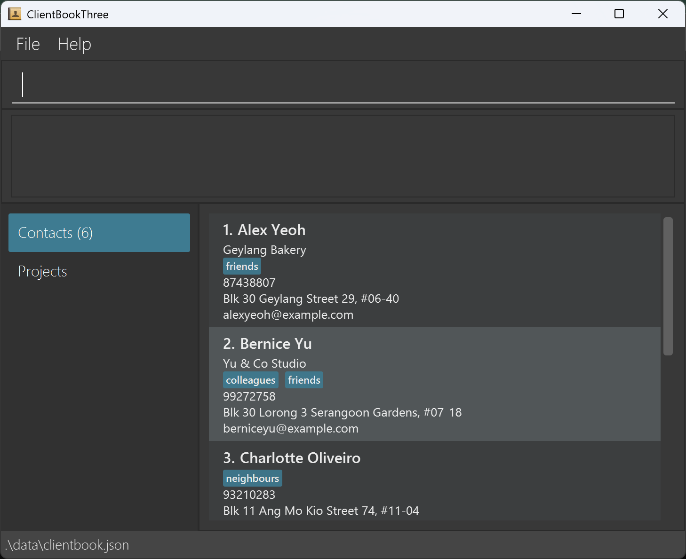
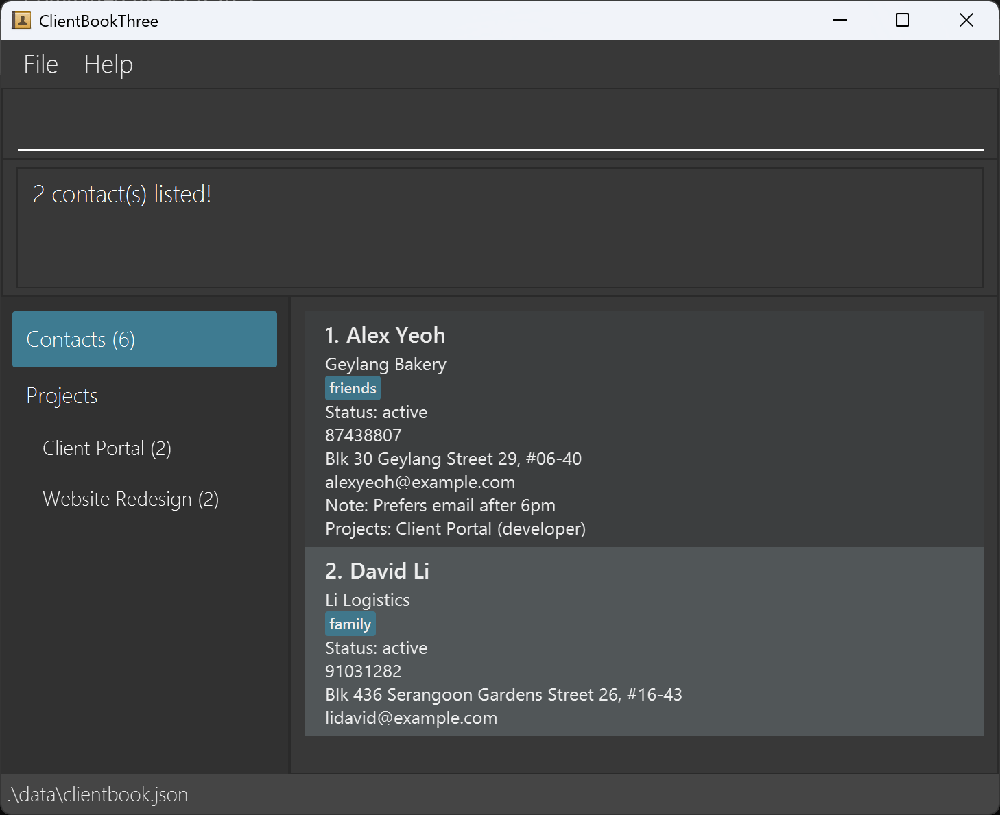

ClientBookThree is a **desktop app for freelance software developers to keep track of their clients and the projects they work on together**, optimized for use through a Command Line Interface (CLI) while still having a Graphical User Interface (GUI). If you type quickly, ClientBookThree lets you record clients, see where each one stands, and see who is on which project faster than a typical GUI app.

* Table of Contents
{:toc}

--------------------------------------------------------------------------------------------------------------------

## Quick start

1. Ensure that Java `25` or later is installed on your computer.<br>
   **Mac users:** Ensure you have the precise JDK version prescribed [here](https://se-education.org/guides/tutorials/javaInstallationMac.html).

1. Download the latest `clientbook.jar` from [our releases page](https://github.com/AY2627S1-CS2103-F09-2/tp/releases).

1. Copy the file to the folder you want to use as the _home folder_ for ClientBookThree. Your data is saved in a `data` folder inside it.

1. Open a terminal, `cd` to the folder containing the JAR file, and run `java -jar clientbook.jar`.<br>
   A window similar to the one below should appear in a few seconds. It starts with some sample contacts for you to try commands on. The sidebar on the left lists your projects once you create some.<br>
   

1. Type a command in the command box and press Enter to execute it. For example, type **`help`** and press Enter to open the help window.<br>
   Some example commands you can try:

   * `list` : Lists all contacts.

   * `add n/Mei Ling p/+65 9123 4567 e/meiling@acme.com c/Acme Pte Ltd` : Adds a client named `Mei Ling` who works at `Acme Pte Ltd`.

   * `status 1 active` : Marks the 1st contact in the list as an active client.

   * `project create Client Portal` : Creates a project named `Client Portal`.

   * `project add 1,2 Client Portal r/developer` : Adds the first two contacts to `Client Portal` as developers.

   * `delete 3` : Deletes the 3rd contact shown in the current list.

   * `find acme` : Finds contacts whose name or company contains `acme`. Use `list` to show everyone again.

   * `clear` : Deletes all contacts.

   * `exit` : Exits the app.

1. Refer to the [Features](#features) section below for details of each command.

--------------------------------------------------------------------------------------------------------------------

## Features

<div markdown="block" class="alert alert-info">

**:information_source: Notes about the command format:**<br>

* Words in `UPPER_CASE` are the parameters to be supplied by the user.<br>
  For example, in `add n/NAME`, replace `NAME` with a value such as `John Doe`.

* Items in square brackets are optional.<br>
  For example, `n/NAME [t/TAG]` can be used as `n/John Doe t/friend` or as `n/John Doe`.

* Items followed by `…`​ can appear zero or more times.<br>
  For example, `[t/TAG]…​` may be omitted, or written as `t/friend` or `t/friend t/family`.

* Parameters can be in any order.<br>
  For example, if the command specifies `n/NAME p/PHONE_NUMBER`, `p/PHONE_NUMBER n/NAME` is also acceptable.

* Extra text after commands that take no parameters (`help`, `exit` and `clear`) is ignored.<br>
  For example, `help 123` is interpreted as `help`.

* Command words ignore case. For example, `LIST` and `List` work like `list`.

* `INDEX` and `CLIENT_INDEX` refer to the numbers shown in the contact list currently displayed, e.g. after a `find`, `list s/STATUS` or `project view`. They must be one of those numbers.

* If you are using a PDF version of this document, be careful when copying and pasting commands that span multiple lines as space characters surrounding line-breaks may be omitted when copied over to the application.
</div>

### Viewing help: `help`

Shows a message explaining how to access the help page.


Format: `help`


### Adding a person: `add`

Adds a person to the client book.

Format: `add n/NAME p/PHONE_NUMBER e/EMAIL [a/ADDRESS] [c/COMPANY] [t/TAG]…​`

* The address and the company are optional, e.g. for a remote client or a freelancer.
* The company is shown under the contact's name.

<div markdown="span" class="alert alert-primary">:bulb: **Tip:**
A person can have any number of tags, including zero.
</div>

Examples:
* `add n/John Doe p/98765432 e/johnd@example.com a/John street, block 123, #01-01`
* `add n/Mei Ling p/91234567 e/meiling@acme.com c/Acme Pte Ltd` adds Mei Ling, who works at Acme Pte Ltd.
* `add n/Betsy Crowe t/friend e/betsycrowe@example.com a/Newgate Prison p/1234567 t/criminal`

### Creating a project: `project create`

Creates a project in the client book.

Format: `project create NAME`

* The name must not be blank and can contain spaces. Quotes are not required.
* Leading and trailing whitespace is trimmed, and repeated spaces are collapsed.
* Project names must be unique, ignoring case and normalized spaces. For example, after creating `Client Portal`, creating `client   portal` is rejected.

Example: `project create Client Portal`

### Attaching a client to a project: `project add`

Attaches an existing client to an existing project.

Format: `project add CLIENT_INDEX[,CLIENT_INDEX...] PROJECT [r/ROLE]`

* The index refers to the number shown in the current client list and must be a positive integer.
* The project must already exist. Use `project create NAME` to create it first.
* Project names can contain spaces without quotes. Matching ignores case and normalized spaces.
* Separate multiple client indexes with commas, without spaces, e.g. `1,2,4`.
* When adding several clients, those already in the project are skipped and listed in the result. Adding a single client who is already in the project is rejected.
* Give the clients a role on this project with `r/ROLE`, e.g. `r/UI designer`. The role must come last: everything after ` r/` is the role, and it can contain spaces.
* A client's role belongs to one project, so a client can have a different role on each project. Use `project role` to change it later.
* A client can belong to multiple projects, and a project can have multiple clients.

Examples:

* `project add 1 Client Portal` attaches the first displayed client to `Client Portal`.
* `project add 1,2,4 Client Portal r/developer` attaches several clients with `developer` role.
* `find Betsy` followed by `project add 1 Client Portal` attaches the first client in the search results.

### Detaching a client from a project: `project remove`

Detaches an existing client from an existing project.

Format: `project remove CLIENT_INDEX[,CLIENT_INDEX...] PROJECT`

* The index refers to the number shown in the current client list and must be a positive integer.
* Project names can contain spaces without quotes. Matching ignores case and normalized spaces.
* Separate multiple client indexes with commas, without spaces, e.g. `1,2,4`.
* When removing several clients, those not in the project are skipped and listed in the result. Removing a single client who is not in the project is rejected.
* The project must exist. Otherwise, the command is rejected.
* The client and project remain in the client book, even when the project has no members afterwards.
* Other clients' memberships and the client's memberships in other projects are preserved.

Examples:

* `project remove 1 Client Portal` detaches the first displayed client from `Client Portal`.
* `project remove 1,2,4 Client Portal` detaches several clients.
* `find Betsy` followed by `project remove 1 Client Portal` detaches the first client in the search results.

### Listing a client's projects: `project list`

Shows the projects assigned to an existing client.

Format: `project list CLIENT_INDEX`

* The index refers to the number shown in the current client list and must be a positive integer.
* Shows each project on a separate line, in join order. Role appears in parentheses when set.
* Shows a message when the client has no projects.
* Keeps the current client filter and project memberships unchanged.

Examples:

* `project list 1` shows the first displayed client's projects.
* `find Betsy` followed by `project list 1` shows the projects of the first client in the search results.

### Changing a client's project role: `project role`

Changes a client's role on a project they are already in.

Format: `project role CLIENT_INDEX PROJECT r/ROLE`

* The project must exist, and the client must already be in it.
* The role must come last: everything after ` r/` is the role, and it can contain spaces.
* The role only applies to this project, so one client can have a different role on each project. Roles are shown on the contact card and in `project list`, e.g. *Client Portal (UI designer)*.

Examples:

* `project role 1 Client Portal r/UI` changes the first contact's role on `Client Portal` to `UI`.
* `project role 2 Client Portal r/Lead developer` changes the second contact's role to `Lead developer`.

### Viewing a project's clients: `project view`

Filters the contact list to show only the clients belonging to an existing project.

Format: `project view PROJECT`

* Project names can contain spaces without quotes. Matching ignores case and normalized spaces.
* The project must exist. Otherwise, the command is rejected and the current list is kept.
* Replaces any previous contact filter and shows the project's clients in their original contact list order.
* Shows the number of clients found, or an empty list and a message when the project has no clients.
* The displayed list updates when project memberships change. Client data and memberships are preserved by viewing.
* Use `list` to show all contacts again.

Examples:

* `project view Client Portal` shows only the clients in `Client Portal`.
* `project view client   portal` does the same, since matching ignores case and extra spaces.

### Switching between contacts and projects with the sidebar

The sidebar on the left of the window shows **Contacts** and every project, each with its number of clients, e.g. *Client Portal (3)*.

* Click a project to show its clients. This is the same as `project view PROJECT`.
* Click **Contacts** to show every contact again. This is the same as `list`.
* The current view is highlighted. After `find` or `list s/STATUS`, nothing is highlighted, since the list shows neither all contacts nor one project.
* The sidebar updates straight away when projects or their clients change. If there are many projects, scroll the project list.
* After clicking, you can keep typing commands: the command box is ready for input.

### Listing all projects: `project all`

Shows every project with its number of clients.

Format: `project all`

* Takes no arguments.
* Shows one project per line, in the order the projects were created, including projects with no clients.
* Counts all clients assigned to each project, regardless of the current contact filter.
* A client who belongs to multiple projects is counted in each of those projects.
* Shows a message when no projects exist.
* Keeps the current contact filter, client data, and project memberships unchanged.
* A project can be named `all`: `project all` lists every project, while `project view all` shows that project's clients.

Example: `project all`

Example output:

```text
Projects:
Client Portal: 2 clients
Website Redesign: 1 client
Internal Tools: 0 clients
```

### Deleting a project: `project delete`

Deletes a project and removes it from every client in it.

Format: `project delete PROJECT`

* Project names can contain spaces without quotes. Matching ignores case and normalized spaces.
* The project must exist. Otherwise, the command is rejected.
* Every client in the project is removed from it, but the clients themselves stay in the client book, along with their other projects.
* The result shows how many clients the project was removed from.
* Deleting a project cannot be undone. To get it back, create it again with `project create` and add its clients with `project add`.

Examples:

* `project delete Client Portal` deletes `Client Portal` and removes it from every client in it.
* `project delete client   portal` does the same, since matching ignores case and extra spaces.

### Keeping a note on a contact: `note`

Keeps a short note against a contact, such as their timezone or how they prefer to be contacted.

Format: `note INDEX [TEXT]`

* Replaces any note the contact already has.
* Leave out `TEXT` to remove the note.
* The index refers to the number shown in the current contact list and must be a positive integer.
* Everything after the index is the note, so it may contain any characters. Spaces at the start and end are removed.
* The note is shown on the contact card. `edit` keeps it unchanged.

Examples:

* `note 1 Based in London, prefers email` keeps that note against the first contact.
* `note 1` removes the first contact's note.

### Listing contacts: `list`

Shows all contacts, or only the contacts with a given engagement status.

Format: `list [s/STATUS]`

* `list` shows every contact.
* `list s/STATUS` shows only the contacts with that status: `lead`, `active`, `on hold`, `done`, or `none` for contacts without a status.
* The status ignores case, and `on-hold` or `onhold` also mean `on hold`.

Examples:

* `list` shows every contact.
* `list s/active` shows the clients whose engagement is active.

### Setting a client's status: `status`

Records where a client's engagement stands.

Format: `status INDEX STATUS`

* `STATUS` is one of `lead`, `active`, `on hold` or `done`. Use `none` to clear a contact's status.
* The index refers to the number shown in the current contact list and must be a positive integer.
* The status ignores case, and `on-hold` or `onhold` also mean `on hold`.
* The status is shown on the contact card. Contacts without a status, such as a client's finance officer, show no status line.
* `edit` keeps a contact's status unchanged.

Examples:

* `status 1 active` marks the first contact's engagement as active.
* `status 2 on hold` puts the second contact's engagement on hold.
* `status 2 none` clears the second contact's status.

### Editing a person: `edit`

Edits an existing person in the client book.

Format: `edit INDEX [n/NAME] [p/PHONE] [e/EMAIL] [a/ADDRESS] [c/COMPANY] [t/TAG]…​`

* Edits the person at the specified `INDEX`. The index refers to the index number shown in the displayed person list. The index **must be a positive integer** 1, 2, 3, …​
* At least one of the optional fields must be provided.
* Existing values will be updated to the input values.
* When editing tags, all of the person's existing tags are removed; adding tags is not cumulative.
* To remove a person's address, enter `a/` without an address after it. Other details remain unchanged unless specified.
* To remove all of a person's tags, enter `t/` without a tag after it.
* To remove a person's company, enter `c/` without a company after it.

Examples:
*  `edit 1 p/91234567 e/johndoe@example.com` Edits the phone number and email address of the 1st person to be `91234567` and `johndoe@example.com` respectively.
*  `edit 1 a/` Removes the address of the 1st person.
*  `edit 2 n/Betsy Crower t/` Edits the name of the 2nd person to be `Betsy Crower` and clears all existing tags.
*  `edit 3 c/Globex Corp` Changes the company of the 3rd person to `Globex Corp`.
*  `edit 3 c/` Removes the company of the 3rd person.

### Locating persons by name or company: `find`

Finds persons whose names or companies contain any of the given keywords.

Format: `find KEYWORD [MORE_KEYWORDS]`

* The search is case-insensitive; for example, `hans` matches `Hans`.
* Keyword order does not matter; for example, `Hans Bo` matches `Bo Hans`.
* The search looks at names and companies only, not phone numbers, emails, addresses, tags or notes.
* Partial words match anywhere in a name or company; for example, `ali` matches `Alice`, and `acme` matches a person at `Acme Pte Ltd`.
* Persons matching at least one keyword are returned (an `OR` search); for example, `Hans Bo` returns `Hans Gruber` and `Bo Yang`.

Examples:
* `find ali` returns `Alice` and `Alice Pauline`
* `find acme` returns everyone whose company contains `acme`, e.g. `Acme Pte Ltd`
* `find John` returns `john` and `John Doe`
* `find alex david` returns `Alex Yeoh`, `David Li`<br>
  

### Deleting a person: `delete`

Deletes the specified person from the client book.

Format: `delete INDEX`

* Deletes the person at the specified `INDEX`.
* The index refers to the index number shown in the displayed person list.
* The index **must be a positive integer** 1, 2, 3, …​

Examples:
* `list` followed by `delete 2` deletes the 2nd person in the client book.
* `find Betsy` followed by `delete 1` deletes the 1st person in the results of the `find` command.

### Clearing all entries: `clear`

Deletes all contacts and all projects from the client book.

Format: `clear`

<div markdown="span" class="alert alert-warning">:exclamation: **Caution:**
`clear` cannot be undone. If you might need the data later, make a copy of `data/clientbook.json` first.
</div>

### Exiting the program: `exit`

Exits the program.

Format: `exit`

### Saving the data

ClientBookThree automatically saves data after every command. You do not need to save manually.

### Editing the data file

ClientBookThree data is saved automatically as a JSON file `[JAR file location]/data/clientbook.json`. Advanced users are welcome to update data directly by editing that data file.

<div markdown="span" class="alert alert-warning">:exclamation: **Caution:**
If your changes make the data file invalid, ClientBookThree starts with an empty client book at the next run. The invalid file remains on disk until you run a command (ClientBookThree saves after every command). Still, we recommend backing up the file before editing it.<br>
Furthermore, certain edits can cause ClientBookThree to behave in unexpected ways (e.g., if a value entered is outside of the acceptable range). Therefore, edit the data file only if you are confident that you can update it correctly.
</div>

--------------------------------------------------------------------------------------------------------------------

## FAQ

**Q**: How do I transfer my data to another computer?<br>
**A**: Install the app on the other computer and overwrite the data file it creates with the data file from your previous ClientBookThree home folder.

**Q**: Nothing happens when I double-click `clientbook.jar`. What should I do?<br>
**A**: Double-clicking a JAR file does not work on some systems, or may start it with a different Java version. Open a terminal in the folder containing the file and run `java -jar clientbook.jar` instead. Run `java -version` first to check that you have Java 25.

**Q**: Where is my data saved?<br>
**A**: In `data/clientbook.json`, inside the folder you run the JAR file from. Your preferences (e.g. the window size) are saved in `preferences.json` in the same folder.

--------------------------------------------------------------------------------------------------------------------

## Known issues

1. **When using multiple screens**, if you move the application to a secondary screen, and later switch to using only the primary screen, the GUI will open off-screen. The remedy is to delete the `preferences.json` file created by the application before running the application again.
2. **If you minimize the Help Window** and then run the `help` command (or use the `Help` menu, or the keyboard shortcut `F1`) again, the original Help Window will remain minimized, and no new Help Window will appear. The remedy is to manually restore the minimized Help Window.
3. **If the JAR file is in a write-protected folder** (e.g. some system or network folders), ClientBookThree cannot save your data: each command shows an error saying it could not save the data due to insufficient permissions. The remedy is to move the JAR file to a folder you can write to, such as one in your home folder, and run it from there.
4. **On macOS, if the main window is in full-screen mode**, the Help Window may open as a separate full-screen space or behind the main window. The remedy is to exit full-screen mode before opening the Help Window, or to switch to it with Mission Control.

--------------------------------------------------------------------------------------------------------------------

## Command summary

Action | Format, Examples
--------|------------------
**Add** | `add n/NAME p/PHONE_NUMBER e/EMAIL [a/ADDRESS] [c/COMPANY] [t/TAG]…​` <br> e.g., `add n/James Ho p/22224444 e/jamesho@example.com a/123, Clementi Rd, 1234665 c/Acme Pte Ltd t/friend t/colleague`
**Clear** | `clear`
**Create project** | `project create NAME`<br> e.g., `project create Client Portal`
**Attach client to project** | `project add CLIENT_INDEX[,CLIENT_INDEX...] PROJECT [r/ROLE]`<br> e.g., `project add 1 Client Portal r/developer`
**Detach client from project** | `project remove CLIENT_INDEX[,CLIENT_INDEX...] PROJECT`<br> e.g., `project remove 1,2 Client Portal`
**List client projects** | `project list CLIENT_INDEX`<br> e.g., `project list 1`
**Change project role** | `project role CLIENT_INDEX PROJECT r/ROLE`<br> e.g., `project role 1 Client Portal r/UI`
**View project clients** | `project view PROJECT`<br> e.g., `project view Client Portal`
**List all projects** | `project all`
**Delete project** | `project delete PROJECT`<br> e.g., `project delete Client Portal`
**Delete** | `delete INDEX`<br> e.g., `delete 3`
**Edit** | `edit INDEX [n/NAME] [p/PHONE_NUMBER] [e/EMAIL] [a/ADDRESS] [c/COMPANY] [t/TAG]…​`<br> e.g., `edit 2 n/James Lee e/jameslee@example.com`
**Find** | `find KEYWORD [MORE_KEYWORDS]`<br> e.g., `find James Jake`, `find acme`
**List** | `list [s/STATUS]`<br> e.g., `list`, `list s/active`
**Note** | `note INDEX [TEXT]`<br> e.g., `note 1 Based in London, prefers email`
**Set status** | `status INDEX STATUS`<br> e.g., `status 1 active`
**Help** | `help`
**Exit** | `exit`
