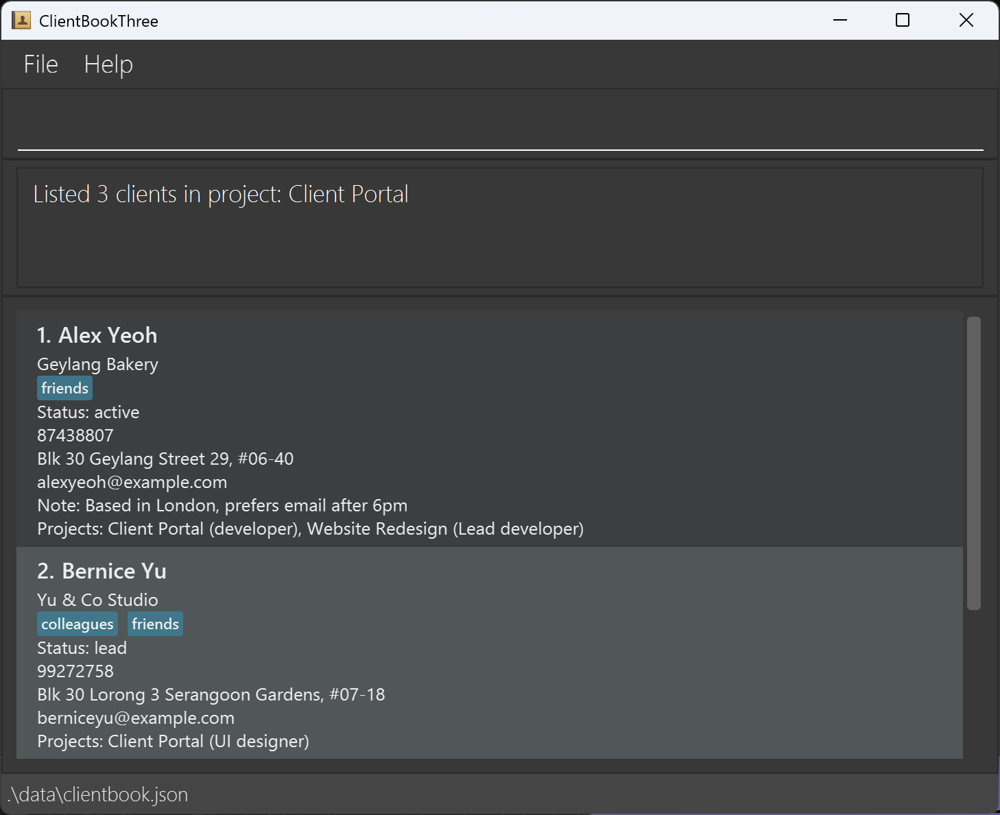

**ClientBookThree is a desktop app for freelance software developers to keep track of their clients and the projects they work on together.** It is optimized for typing commands, while still showing everything in a clear graphical view.

With ClientBookThree, you can:

* record each client with their company, and a short note such as their timezone or how they prefer to be contacted;
* mark where each client stands (lead, active, on hold or done) and list clients by status;
* group clients into projects, give each client a role on each project, and see who is on a project at a glance;
* find a client by part of their name or company.

* Start using ClientBookThree with the [_Quick Start_ section of the **User Guide**](UserGuide.html#quick-start).
* Learn how ClientBookThree works in the [**Developer Guide**](DeveloperGuide.html).

**Acknowledgements**

* ClientBookThree is based on [AddressBook-Level3](https://se-education.org/addressbook-level3/) by the [SE-EDU initiative](https://se-education.org).
* Libraries used: [JavaFX](https://openjfx.io/), [Jackson](https://github.com/FasterXML/jackson), [JUnit5](https://github.com/junit-team/junit5)
